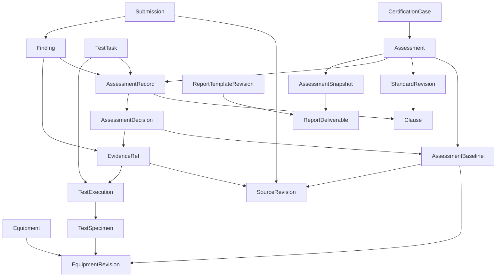

# CertReporter：以 Assessment Record 为中心的领域模型（讨论稿）

日期：2026-10-08。本文提出新的产品与领域设计，不表示模型已经实施或获得最终确认。按用户最新约束，不考虑历史数据迁移；以下建议以新建评估系统、选择性复用 DOCX 渲染逻辑为基础。

## 1. 业务目标与设计前提

核心行为：工程师围绕某个设备版本，依据某个标准版本，持续审查资料、执行测试、记录判断、推动整改并复核；最后将已确认的评估结果渲染为认证报告。

本次已明确的方向：

- Assessment Record 是核心业务事实，不再属于报告章节。
- 评估可以在报告模板尚未存在时开始并完成。
- 客户整改和新资料提交后，可以持续评估并保留历史判断。
- Report 是评估结果的交付视图；DOCX 模板定义布局和输出所需的补充字段。
- Agent 辅助分析、计划、反馈整理和经验积累；工程师承担专业判断和业务确认。

第一版建议范围：一个 Assessment 对应一个设备配置版本与一个固定标准版本。一个 CertificationCase 可以包含多个 Assessment，以便同设备申请多个标准认证。跨标准共享证据，但不自动共享结论。

本文是应用领域 ontology，不引入 RDF、图数据库或通用 ontology 引擎。关系本身需要明确，存储机制另行选择。

## 2. 核心概念与关系

| 概念 | 业务含义 | 主要关系 |
|---|---|---|
| CertificationCase | 一次设备认证申请及其协作过程 | 关联申请方、设备、负责人、Assessment 和提交批次 |
| Equipment | 被评估设备的持续身份 | 拥有多个 EquipmentRevision |
| EquipmentRevision | 一次明确的设计与配置版本 | 定义型号、配置、选件、适用范围；关联资料版本 |
| TestSpecimen | 实际受测设备或样机 | 关联 EquipmentRevision，记录序列号和实际配置、差异 |
| StandardRevision | 本次采用的固定标准内容版本 | 包含 Clause、规范文本、条款结构和评估字段定义 |
| Assessment | 对设备版本是否符合标准的评估工作 | 引用固定 StandardRevision，维护当前基线和条款记录目录 |
| AssessmentBaseline | 一轮评估所采用的设备及资料集合 | 引用 EquipmentRevision、明确的 SourceRevision 集合 |
| AssessmentRecord | 对一条标准要求持续维护的评估记录 | 属于 Assessment，引用条款，拥有历次 AssessmentDecision |
| AssessmentDecision | 一次基于明确基线和证据的判断 | 记录适用性、符合性、理由、证据、作者与确认信息 |
| SourceRevision | 一份文档、图纸等材料的不可变版本 | 来自 Submission，属于具体设备或项目 |
| EvidenceRef | 判断所引用的证据位置 | 指向 SourceRevision 或 TestExecution 的具体部分 |
| TestTask | 为解决一个或多个评估问题而计划的测试 | 关联条款记录、测试方法、判据、负责人和受测配置要求 |
| TestExecution | 一次实际测试及其观察结果 | 属于 TestTask，引用样机、条件、仪器、原始结果和附件 |
| Finding | 需要处理或澄清的具体问题 | 关联一个或多个 AssessmentRecord、证据和整改响应 |
| Submission | 客户一次提交资料或整改响应的批次 | 引用材料版本，包含针对 Finding 的响应 |
| AssessmentSnapshot | 一次经授权确认的完整评估结果快照 | 固定基线、条款决策、测试与问题状态、整体结论 |
| ReportTemplateRevision | 固定的 DOCX 模板版本 | 定义评估数据绑定、版式和补充字段 schema |
| ReportDeliverable | 一次报告编制与正式输出记录 | 引用 AssessmentSnapshot、模板版本、补充字段和生成文件 |

关系主线：

设备版本描述客户声明的设计和配置；样机描述实际测试对象。测试结果适用于哪些设备配置，需要工程师明确确认，不能仅凭型号相同自动推断。

Clause 保留标准的层级和文字结构。AssessmentRecord 只为需要独立判断的要求创建；章节标题和汇总条款不自动成为额外的独立评估单元。首版采用一条可评估 Clause 对应一份 Record；一个条款含多个检查点时，先在该 Record 下保存检查点结果，不额外引入 Requirement 实体。遇到需要独立审核、独立版本的检查点，再评估拆分。

## 3. Assessment Record 的结构

AssessmentRecord 是持续身份；AssessmentDecision 是其具体版本的判断。当前工作状态可以修改，已确认的判断不可覆盖。

| 字段组 | 建议内容 |
|---|---|
| 身份 | id、assessment_id、clause_ref（标准版本与稳定条款标识） |
| 当前工作 | owner_id、reviewer_id、work_state、blocking_refs、revision |
| 当前判断 | working_decision、latest_confirmed_decision_id |
| 基线适用性 | current_baseline_id、freshness（current / needs_reassessment） |
| 历史 | 历次决策及其 supersedes / carried_forward_from 关系 |

AssessmentDecision 包含：

- baseline_id：判断所针对的设备配置和资料集合。
- applicability：undetermined / applicable / not_applicable，及理由。
- conformity：undetermined / conforms / does_not_conform；不适用时无符合性值。
- rationale：专业判断理由。
- evidence_refs：包含定位和证据版本的引用。
- assessment_values：遵循固定条款评估 schema 的结构化内容。
- origin：human / agent_assisted；记录实际操作者、Agent Work/turn 引用和来源。
- review_state：draft / submitted / confirmed / returned。
- confirmed_by、confirmed_at、supersedes_decision_id。

语义固定的适用性、符合性、确认信息由领域模型定义；测量值、风险等级、检查清单等可变字段由条款 schema 定义。schema 不能重定义核心状态语义。

工作状态建议：todo / in_progress / awaiting_information / awaiting_test / awaiting_customer / ready_for_review / done。它描述当前工作，不替代符合性结论。实际阻塞原因通过引用具体的 TestTask、Finding 或资料请求表达；允许同时存在多个阻塞事项。

关键不变量：

1. 同一 Assessment、同一可评估条款只有一个 AssessmentRecord 持续身份。
2. 已确认 Decision 必须绑定固定基线、固定标准内容、操作者和确认者。
3. 不适用必须有理由并经过确认；隐藏条款或不展示结果不等于不适用。
4. 尚未测试或资料不足不能自动写为符合。
5. 填完必填字段不等于工程师已确认符合。
6. confirmed Decision 不原地修改；修正产生新的 Decision，旧结果保留。
7. 新基线建立后，受影响或影响未明确的记录进入 needs_reassessment。
8. 跨基线沿用结论必须产生明确的沿用决定，说明依据，保留旧来源；不能悄悄改写旧 Decision 的 baseline_id。
9. 确认只作用于提交时的 revision；后续改动使待确认版本失效。

## 4. 证据、测试与整改

### 4.1 资料与证据

Submission 是提交批次，SourceRevision 是不可变材料版本，EvidenceRef 是具体定位。不要为每次引用复制文件。

EvidenceRef 建议包括 source_kind、source_revision_id、locator（页码、图号、区域、段落、测试观察 ID 等）、摘录或说明。Agent 的 OCR、图纸识别或提取结果作为派生材料记录，绑定原始来源和生成过程；模型回答本身不自动成为设备符合性证据。

AssessmentBaseline 固定本轮实际选用的材料清单。客户上传不自动替换当前基线；工程师接受新提交进入评估后，才建立新基线。提交“没有变化”的材料也需要可识别的版本关联。

### 4.2 测试

TestTask 定义要解决什么问题、关联记录、方法、接受判据、条件和受测配置要求。首版 TestPlan 是选定 TestTask 的汇总视图；如果需要正式批准并留存，冻结为 TestPlanSnapshot，不维护另一套任务事实。

TestExecution 记录真实执行者、时间、样机、配置差异、环境条件、仪器信息、测量值、观察结果和原始附件。失败、无效或中止的执行也保留。

测量结果与符合性决策分离。一项测试可以服务多条要求；新的测试结果不会直接覆盖条款结论，而是供工程师形成或确认新 Decision。Agent 可整理计划和录入有来源的结果，不得把未执行的计划当作实际测试。

### 4.3 问题与整改

Finding 是需要闭环的业务对象，包含问题描述、类型、关联条款、证据、整改要求或澄清问题、负责人、状态和响应历史。类型先采用 nonconformity / clarification / recommendation，只有阻碍符合性确认的问题参与结案门槛。

状态建议：open → awaiting_response → ready_for_verification → closed；允许复核失败后回到 awaiting_response，闭合问题因新证据重新打开时记录原因。

CustomerResponse 作为 Submission 中针对 Finding 的响应，记录说明、新材料和客户声明；它不直接关闭 Finding。CloseFinding 用例需要工程师复核及关联当前有效 Decision / 测试结果。

FeedbackPackage 是选定 Finding 及整改要求的对外反馈快照。内部分析笔记、Agent 对话和所有附件不默认对客户开放。编制、批准发送、实际发送分别记录；Agent 可以起草反馈，不能自行发送。

## 5. 整体评估与最终报告

Assessment 工作生命周期建议：open → in_review → completed；需要补充工作时从 in_review 返回 open。项目归档是管理状态，不替代评估结论。

整体结论独立表达：undetermined / conforms / does_not_conform。完成评估不必意味着设备符合；不符合也可以形成完整、可交付的评估结果。成功认证报告的输出门槛应要求整体结论为 conforms，普通阶段评估报告可以表达未完成或不符合。

系统先计算“可提交复核”的条件：

- 所有范围内的可评估要求均有当前基线上的已确认决策。
- applicable 条款的符合性不为 undetermined。
- not_applicable 有已确认理由。
- 必要测试已有有效且适用的执行证据。
- 没有 needs_reassessment 的记录。
- 对于成功认证，没有尚未闭环的阻断问题和 does_not_conform 决策。

聚合用例根据决策和规则生成整体结果，再由有权限的工程师确认并建立 AssessmentSnapshot。具体行业中的保留项、豁免、条件性结论等规则尚未确认，不预设额外结论类型。

AssessmentSnapshot 固定：标准内容版本、设备/资料基线、全部有效 Decision 引用、证据和测试引用、Finding 状态、整体结论、范围与限制、确认者及时间。

报告流程：

1. 选择 AssessmentSnapshot 和 ReportTemplateRevision。
2. 系统构建只读 assessment_context，包括设备、标准、条款结果、证据与汇总。
3. 根据模板 supplement_schema 收集缺失的交付字段，例如报告编号、签发地点、封面联系人。
4. 校验模板绑定和所有必需字段，生成预览。
5. 经授权进行正式输出，冻结补充字段、模板版本、快照引用及输出文件校验信息。

模板补充字段不得覆写 assessment_context。型号、认证范围、测试条件、符合性结论等影响判断的内容，应回到评估领域修正，产生新快照，而不是只改报告。

ReportDeliverable 的 revision 可以产生多个文件输出；已正式输出的版本不原地覆盖。DOCX 渲染错误、模板缺少绑定、证据附件不可用应明确失败，不能生成看似完整的正式报告。

ReportType 可以逐步收缩为 ReportTemplateRevision 的配置入口：DOCX、字段绑定、补充字段定义、输出规则。报告格式变化不再决定评估范围、工作划分和是否符合。

## 6. 聚合边界与领域职责

| 聚合/模块 | 权威职责 | 不拥有 |
|---|---|---|
| CertificationCase | 项目身份、参与人、申请范围和 Assessment 目录 | 每条评估记录的并发编辑 |
| Equipment | 设备身份及版本目录 | 标准符合性结论 |
| Standard | 标准内容、条款结构和 schema 的修订发布 | 项目评估及报告版式 |
| Assessment | 当前基线、条款覆盖范围、整体复核和快照建立 | 以巨型嵌套对象保存全部文件和测试 |
| AssessmentRecord | 单条要求的工作、决策版本与确认 | 客户发送、DOCX 输出 |
| Source/Submission | 文件版本、提交来源及整改响应 | 对新版本是否符合的专业判断 |
| TestTask/TestExecution | 计划和实际执行事实 | 自动替代条款审核 |
| Finding | 问题、整改响应及复核关闭 | 标准全文及报告字段 |
| ReportDeliverable | 模板绑定、交付补充信息、输出版本 | 评估结论和原始测试事实 |

每条 AssessmentRecord 单独控制 expected_revision，避免多人编辑整个项目争抢同一版本。整体复核和快照建立使用一致性读和提交时版本校验，防止“检查通过后记录被修改，但仍完成认证”的竞争问题。具体事务实现留在存储适配器中。

业务模块先采用 assessments、equipment、standards、evidence、testing、findings、reporting 的职责划分，不意味着必须拆为独立服务。

权限至少区分：资料提交、评估编辑、测试结果记录、评估确认、问题关闭、项目结案、报告正式输出。操作者身份来自应用认证；Agent 获得目标 Assessment 范围内的明确权限。工程师是否可以自审仍是业务待定项。

## 7. 用例及 Agent 边界

主要用例：OpenCertificationCase、StartAssessment、AcceptSubmissionAndCreateBaseline、AssessBaselineImpact、UpdateAssessmentRecord、SubmitDecision、ConfirmDecision、CarryForwardDecision、PlanTest、RecordTestExecution、RaiseFinding、RecordCustomerResponse、VerifyAndCloseFinding、SubmitAssessmentReview、CompleteAssessment、GenerateReportPreview、IssueReport。

跨记录的流程策略由上述用例负责；实体承担状态转换与稳定不变量；仓储和渲染接口由用例定义；Django、文件系统、OCR、DOCX、HTTP 均在外层适配器。现有框架的 Clean Architecture 依赖方向继续保留。

Airic Work 绑定 Assessment；需要时限定到某些 Record、TestTask 或 Finding。Airic 持有对话、轨迹、执行过程和 Operating Model；CertReporter 持有业务事实、权限、校验、确认和审计。Work 结束不代表评估完成，Agent trace 不代替 EvidenceRef。

可授予 Agent 的能力：读取基线资料与条款、保存评估草稿、提出测试任务、提出问题、整理客户反馈、比较资料变更和起草报告补充内容。确认决策、关闭问题、结案、正式报告输出、发送客户反馈仍通过人类业务操作完成。

权限、expected_revision、输入 schema、来源信息和命令回执在应用领域能力入口检查，不依赖 Agent 是否遵守提示词。

可积累经验的来源是已确认 Decision、测试结果、整改闭环以及工程师对 Agent 建议的修正。经 Reflection → Proposal → review → 作者采纳形成版本化的检查方法或工作指引。标准规范文本、项目事实、可演进专业方法三者分别维护；经验不能自行改写标准要求。

## 8. 新建系统与选择性复用

在不要求历史数据迁移和旧系统兼容的前提下，建议新建以 Assessment 为中心的应用。现有系统的 ReportInstance、CDI/SDI、section_index、报告 WorkItem 和 ReportType 驱动的创建流程不作为新系统的业务骨架。

理由：设备身份、资料基线、证据来源、测试执行、整改复核和条款决策都是新流程的一等概念。把它们嵌入旧报告结构会同时改变实体归属、工作划分、状态规则、API 和界面；旧抽象能够保留的部分有限，反而持续增加理解和修改成本。新建范围应以一个设备、一个标准的一轮评估闭环为起点，不一次实现全部扩展。

复用边界：DOCX 渲染能力及其针对渲染行为的测试和模板样例。已核对当前 DocxRendererPort 和 DocxTplRenderer：其入口接收模板、已组装 payload 和附件读取接口，返回 DOCX 字节；渲染器本身不查询报告仓储。它适合作为新 reporting 模块的外层适配器。

迁入时处理少量旧包依赖（错误类型、附件读取接口、返回对象），保留模板循环、富文本、图片、表格和文档片段能力中实际需要的部分。不要连带迁入旧报告数据组装器、章节/子报告编排、ReportType 业务模型和报告审批流程。

新输出契约由新模型定义：固定 AssessmentSnapshot + ReportTemplateRevision + supplemental_values + 附件解析器 → DOCX。模板字段命名重新根据这个契约确定，不要求兼容旧模板命名空间。

既有渲染测试可作为回归起点；新 payload、依赖适配、缺失字段及附件处理仍需在新应用中重新验证。本次只检查了代码结构，没有重新执行渲染测试，也未复制代码或创建新项目。

技术框架与新仓库位置尚未确定。领域模型不依赖是否继续使用 Django、现有前端技术栈或具体数据库。Airic 业务状态与执行轨迹的责任边界可沿用，不以旧 CertReporter 应用结构为前提。

## 9. 实施顺序及验证

1. 核心评估：设备版本、固定标准、基线、Record/Decision 与确认规则。验证无模板也可开展评估；字段填完不能自动确认。
2. 资料与整改：来源定位、提交、新基线、影响评估、Finding 响应与关闭。验证客户回复不能直接关闭，新图纸使相关结论需要重新确认。
3. 测试：TestTask、TestExecution、样机与证据适用性。验证一项测试支持多条要求，执行失败/无效保留，测试计划不能充当结果。
4. 整体复核与输出：一致性快照、简单 DOCX 模板、补充字段及正式输出。验证新评估不能改变旧报告，报告补充字段不能覆盖结论。
5. Agent 和经验：接入上述明确能力并更新上下文；再做从真实资料分析到整改复核的运行闭环。

实体测试验证不变量；用例测试验证权限、状态与跨对象规则；适配器测试验证不可变引用、版本冲突、一致性快照和 DOCX 绑定；端到端用一个真实项目验证资料审查 → 测试 → 整改 → 复核 → 输出。复用的 DOCX 渲染器在新输出契约下执行回归验证。

新系统的实现范围包括领域模型与用例、仓储接口与持久化、API、评估工作区、报告数据组装与 DOCX 适配器、Airic 能力入口和上下文绑定。设计确认后，按新项目技术栈规划具体目录及接口；不要求修改旧 CertReporter 的业务结构。新系统建立自己的架构路由索引，旧系统仅作为渲染逻辑和已知问题的参考。

## 10. 需要在实施前确认的业务规则

- 首版是否采用一个 Assessment 对应一个设备配置与一个标准版本？建议采用；多个标准由同一 Case 下多个 Assessment 表达。
- 是否需要工程师与复核人分离，以及哪些条款需要复核？不要把现有报告 WorkItem 审批规则直接套为新规则。
- 正式交付是否仅包含成功认证报告，还是也包含“不符合评估报告”和阶段反馈？建议共用输出机制，按交付类型设置门槛。
- 客户是否登录系统提交和查看整改，还是首版由工程师代录？这决定门户与可见性范围，不改变内部评估模型。
- 设备配置选件是否需要分别出具结论？如果真实项目存在明显配置差异，不能仅靠通用备注表达适用范围。

这些问题不阻碍讨论核心 ontology；正式实现相应政策前，需要客户或产品负责人给出规则。
